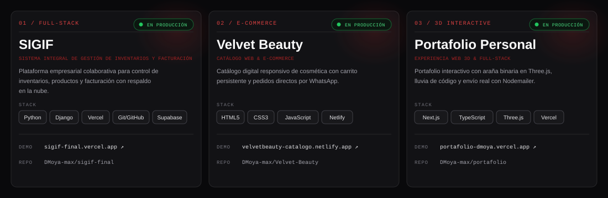

<div align="center">


</div>

## `// About Me`

```js
const daniel = {
  name: "Daniel Jose Moya Quiroz",
  role: "Full-Stack Software Developer",
  education: "ADSO - SENA (Itagüí)",
  experience: "Etapa Productiva @ CODERI",
  location: "Medellín, Colombia",
  workMode: "Modalidad Mixta",
  building: ["SIGIF", "Velvet Beauty", "Experiencias Web 3D"],
};
```

> "Transformo ideas complejas en soluciones digitales sólidas, funcionales y bien estructuradas, cuidando cada detalle de principio a fin."
>
> — Daniel Jose Moya Quiroz

## `// Connect With Me`

<div align="center">

[](https://portafolio-dmoya.vercel.app/)
[](mailto:dmoya1873@gmail.com)
[](https://github.com/DMoya-max)

</div>

## `// Tech Stack`

<div align="center">


</div>

## `// Proyectos Destacados`

<div align="center">



<br/>

[](https://sigif-final.vercel.app/)
[](https://github.com/DMoya-max/sigif-final)
[](https://velvetbeauty-catalogo.netlify.app/)
[](https://github.com/DMoya-max/Velvet-Beauty)
[](https://portafolio-dmoya.vercel.app)
[](https://github.com/DMoya-max/portafolio)

</div>

## `// Estadísticas de GitHub`

<div align="center">


<br/><br/>

<table>
  <tr>
    <td width="50%"></td>
    <td width="50%"></td>
  </tr>
  <tr>
    <td width="50%"></td>
    <td width="50%"></td>
  </tr>
</table>

</div>
