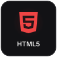

 

### 👨‍💻 Sobre mí

- 🚀 **Soy Desarrollador Web**, enfocado en construir aplicaciones modernas, APIs escalables y experiencias web interactivas de principio a fin.
- 💡 Me apasiona explorar nuevas tecnologías y transformar ideas en soluciones digitales sólidas, cuidando tanto el rendimiento como cada detalle visual.
- 🛠️ Trabajo habitualmente con ecosistemas como **Python, Django, Node.js, React y Next.js**, integrando bases de datos relacionales y NoSQL.
- 🎮 En mi tiempo libre disfruto jugar videojuegos, experimentar con gráficos 3D en la web y seguir perfeccionando mi arquitectura de software.
- 📬 ¡No dudes en contactarme! Puedes visitar mi **[Portafolio Web 3D](https://portafolio-dmoya.vercel.app)** o escribirme directamente a **[dmoya1873@gmail.com](mailto:dmoya1873@gmail.com)**.

 

&nbsp;&nbsp;

 

<table>
<tr>
<td width="33.33%" align="center" valign="top">

  

</td>
<td width="33.33%" align="center" valign="top">

  

</td>
<td width="33.33%" align="center" valign="top">

  

</td>
</tr>
</table>

