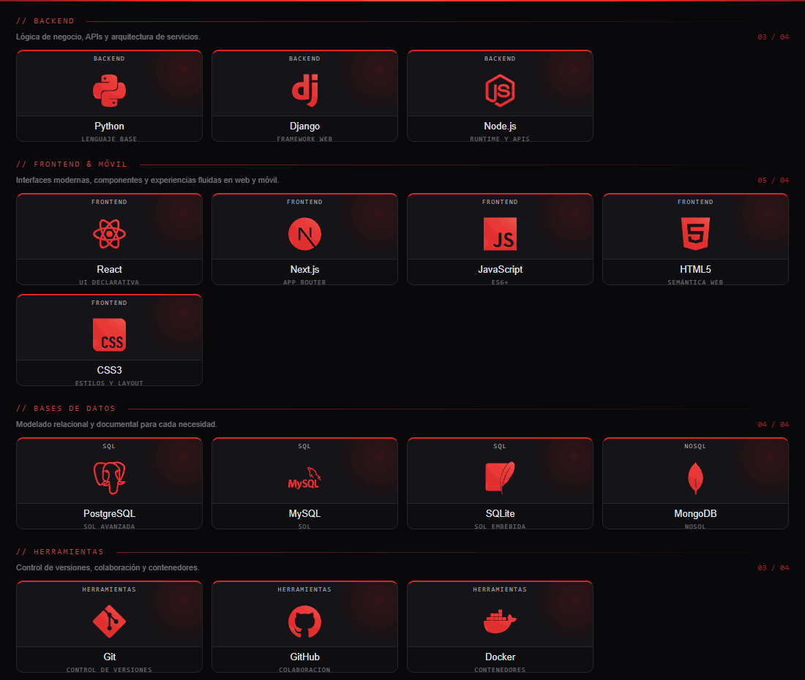
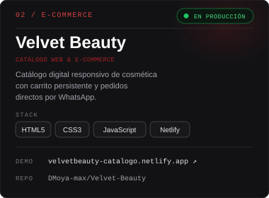

<table>
<tr>
<td width="33.33%" align="center" valign="top">

  

</td>
<td width="33.33%" align="center" valign="top">

  

</td>
<td width="33.33%" align="center" valign="top">

  

</td>
</tr>
</table>

  

 

  

