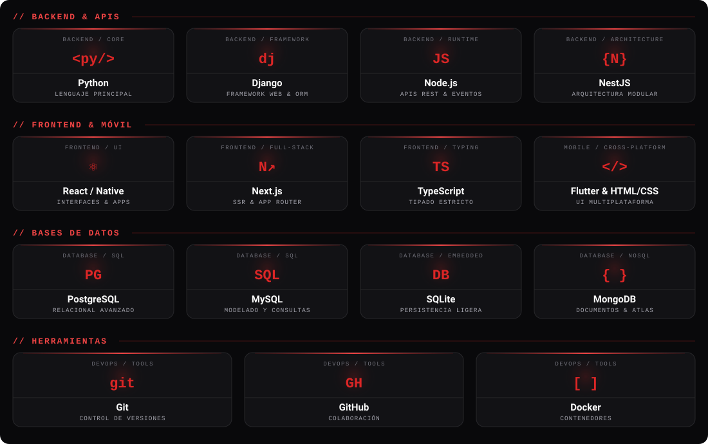

<!-- Banner animado SVG con estética negro mate y rojo metálico -->

  

---

### `// SOBRE MÍ`

Desarrollador de software Full-Stack enfocado en construir aplicaciones web y móviles escalables, interfaces de alto impacto y arquitecturas limpias.

- **Actualmente:** Desarrollando soluciones reales en mi etapa productiva en **CODERI** y perfeccionando aplicaciones Full-Stack.
- **Formación:** Tecnólogo en Análisis y Desarrollo de Software (ADSO) — SENA.
- **Enfoque:** Backend robusto con Python/Django y Node.js/Nest.js, combinado con frontends modernos en React, Next.js y TypeScript.
- **Modalidad:** Disponible para oportunidades en **modalidad mixta** y proyectos freelance.

---

### `// Tech Stack`

  

---

### `// PROYECTOS DESTACADOS`

| Proyecto | Descripción | Stack | Demo |
| :--- | :--- | :--- | :---: |
| **[SIGIF](https://github.com/DMoya-max/sigif-final)** | Sistema Integral de Gestión de Inventarios y Facturación con control empresarial y respaldo en la nube. | `Python` `Django` `Vercel` | [Ver Demo ↗](https://sigif-final.vercel.app/) |
| **[Velvet Beauty](https://github.com/DMoya-max/Velvet-Beauty)** | Catálogo web responsivo y e-commerce de belleza con carrito persistente y pedidos directos por WhatsApp. | `HTML5` `CSS3` `JavaScript` | [Ver Demo ↗](https://velvetbeauty-catalogo.netlify.app/) |
| **[Portafolio Personal](https://github.com/DMoya-max/portafolio)** | Portafolio interactivo con gráficos 3D en tiempo real, lluvia binaria y envío de correo con Nodemailer. | `Next.js` `TypeScript` `Three.js` | [Ver Demo ↗](https://portafolio-dmoya.vercel.app/) |

---

### `// ESTADÍSTICAS DE GITHUB`

  
  

